# Agentic AI Automated Trading Platform

[](https://github.com/robotics-intelligent-systems/jfxai4ats)
[](https://github.com/robotics-intelligent-systems/jfxai4ats)
[](https://github.com/robotics-intelligent-systems/jfxai4ats)
[](https://github.com/robotics-intelligent-systems/jfxai4ats)
[](https://github.com/robotics-intelligent-systems/jfxai4ats)

## Table of Contents

- [Description and Context](#description-and-context)
- [Vision](#vision)
- [Objectives](#objectives)
- [Functional Scope](#functional-scope)
- [Reference Architecture](#reference-architecture)
- [Requirements and SysML baseline](#requirements-and-sysml-baseline)
- [Iterative development](#iterative-development)
- [Core Capabilities](#core-capabilities)
- [AI and Quantitative Intelligence](#ai-and-quantitative-intelligence)
- [Trading and Execution](#trading-and-execution)
- [Market Data](#market-data)
- [Risk Management](#risk-management)
- [Financial Messaging](#financial-messaging)
- [Exchange and Matching Engine Integration](#exchange-and-matching-engine-integration)
- [Simulation and Backtesting](#simulation-and-backtesting)
- [Business Intelligence](#business-intelligence)
- [Software Dependency Compendium](#software-dependency-compendium)
- [Dependency Classification](#dependency-classification)
- [Dependency Matrix](#dependency-matrix)
- [Recommended Technology Stack](#recommended-technology-stack)
- [Data Architecture](#data-architecture)
- [AI Architecture](#ai-architecture)
- [User Guide](#user-guide)
- [Installation Guide](#installation-guide)
- [Dependencies](#dependencies)
- [Testing and Validation](#testing-and-validation)
- [Security and Financial Controls](#security-and-financial-controls)
- [Repository Structure](#repository-structure)
- [Development Workflow](#development-workflow)
- [Contribution](#contribution)
- [Code of Conduct](#code-of-conduct)
- [Authors](#authors)
- [Additional Information](#additional-information)
- [License](#license)
- [Roadmap](#roadmap)

---

# Description and Context

**JFXAI4ATS** is an open-source reference platform for **AI-powered automated trading, quantitative finance, financial market analysis, algorithmic strategy development, execution, risk management, and trading-system engineering**.

The project consolidates an ecosystem of open-source technologies and research projects related to:

- quantitative investment;
- algorithmic trading;
- AI-powered trading agents;
- reinforcement learning;
- financial machine learning;
- market simulation;
- portfolio optimization;
- risk analytics;
- financial messaging;
- FIX protocol integration;
- high-performance market data;
- exchange and matching-engine infrastructure;
- trading APIs;
- backtesting;
- financial performance analysis;
- cloud-native trading systems;
- model-based systems engineering.

The current repository contains a broad technology inventory including Qlib, FinRL, TradingAgents, OctoBot, StockSharp, QuantLib, QuickFIX/J, Aeron, vn.py, Qbot, TradeMaster, WonderTrader, Exchange-Core and other financial technologies. It also incorporates an MBSE/CAD/CAM/CAS engineering structure.  

The project is therefore positioned as a **reference architecture and technology compendium**, rather than claiming that every listed project is a mandatory runtime dependency.

---

# Vision

The long-term objective is to provide a modular open-source architecture for building automated trading systems in which:

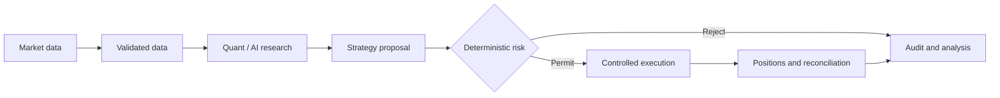

The architecture emphasizes **modularity, reproducibility, observability, explainability, low latency where required, and separation between research, simulation and live execution**.

---

# Objectives

## Primary Objectives

1. Provide a reusable architecture for automated trading systems.
2. Integrate quantitative finance with modern AI.
3. Support multiple trading strategies and asset classes.
4. Support backtesting and simulation before live deployment.
5. Provide interfaces for brokers, exchanges and trading venues.
6. Integrate financial messaging standards such as FIX.
7. Provide portfolio and risk-management capabilities.
8. Support AI agents for research and trading workflows.
9. Enable cloud-native deployment.
10. Maintain a structured software dependency compendium.

## Engineering Objectives

- modular architecture;
- API-first integration;
- event-driven processing;
- reproducible experiments;
- containerized execution;
- automated testing;
- observability;
- auditability;
- secure credential management;
- deterministic backtesting;
- controlled transition from research to production.

---

# Functional Scope

JFXAI4ATS covers the following functional domains:

| Domain | Capability |
|---|---|
| Market Data | Historical and real-time market data |
| Quantitative Research | Feature engineering and statistical analysis |
| Strategy | Algorithmic strategy development |
| AI/ML | ML, DL and reinforcement learning |
| AI Agents | Autonomous research and trading workflows |
| Portfolio | Positions, allocation and performance |
| Risk | Exposure, volatility, drawdown and risk metrics |
| Execution | Order management and execution |
| FIX | Financial Information eXchange integration |
| Brokers | External broker APIs |
| Exchanges | Exchange connectivity |
| Simulation | Market and strategy simulation |
| Backtesting | Historical strategy evaluation |
| BI | Trading and financial analytics |
| Observability | Metrics, logs and traces |
| MBSE | Architecture and systems engineering |

---

# Reference Architecture

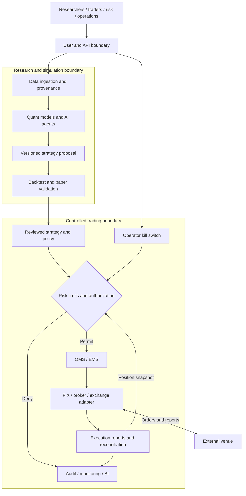

---

# Requirements and SysML baseline

The proposed engineering baseline is specified in [high-level requirements](docs/requirements/high-level-specification.md), with requirement IDs, acceptance cases, interface contracts and open decisions. The editable [SysML model](MBSE/SysML/jfxai4ats-high-level.drawio) contains context, requirement, block, internal-block, activity and verification views. This is a documentation baseline awaiting review; no executable trading capability is established.

---

# Core Capabilities

## 1. Quantitative Investment

The platform can support quantitative investment workflows including:

- alpha research;
- factor modeling;
- stock selection;
- portfolio construction;
- signal generation;
- market prediction;
- statistical arbitrage;
- momentum;
- mean reversion;
- market making;
- volatility strategies;
- portfolio optimization.

Relevant technologies include:

- Qlib;
- FinRL;
- FinML;
- QuantLib;
- Qbot;
- Shark;
- WonderTrader;
- TradeMaster.

---

# AI and Quantitative Intelligence

JFXAI4ATS incorporates AI-oriented technologies for financial decision-support and automated strategy research.

## Machine Learning

Potential workloads include:

- classification;
- regression;
- clustering;
- feature selection;
- time-series forecasting;
- anomaly detection;
- portfolio optimization.

## Deep Learning

Potential models include:

- recurrent neural networks;
- transformers;
- temporal models;
- representation learning;
- sequence models.

## Reinforcement Learning

Reinforcement learning can be used for:

- policy optimization;
- portfolio allocation;
- execution optimization;
- market-making policies;
- dynamic position sizing.

Candidate platforms include:

- FinRL;
- TradeMaster;
- Cloud-native Financial Reinforcement Learning;
- Shark.

---

# AI Trading Agents

The platform can integrate agent-oriented architectures for:

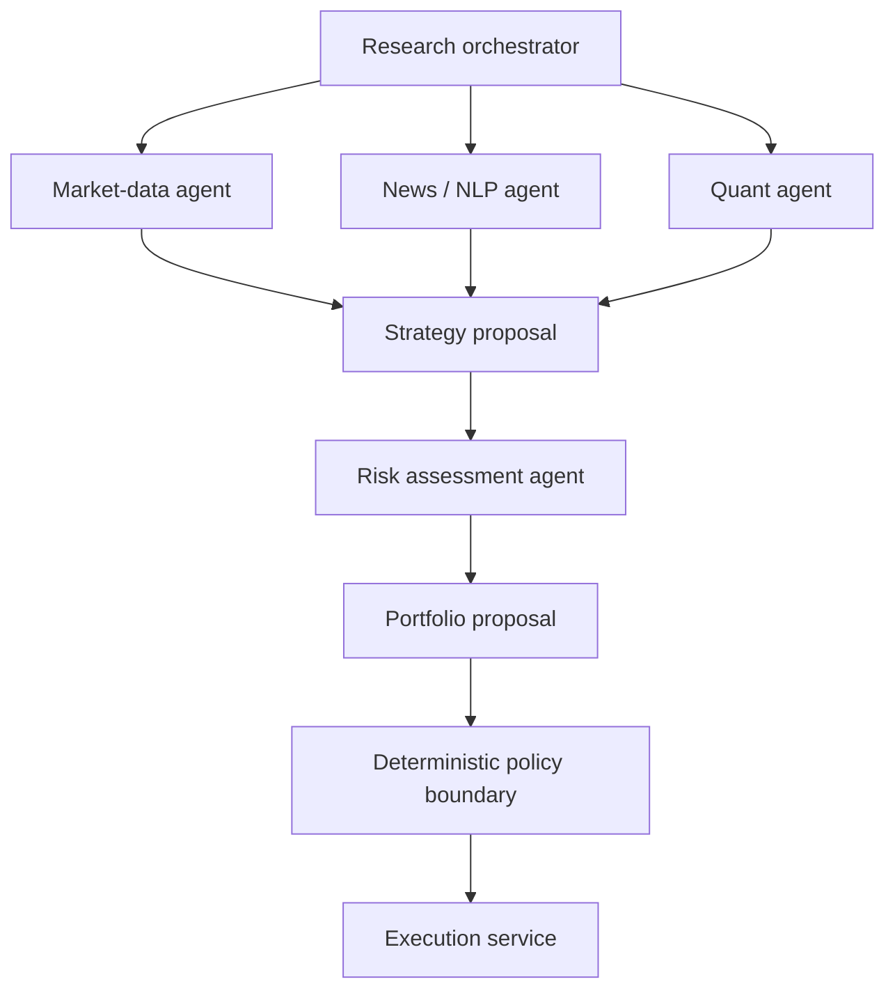

An agent workflow can follow:

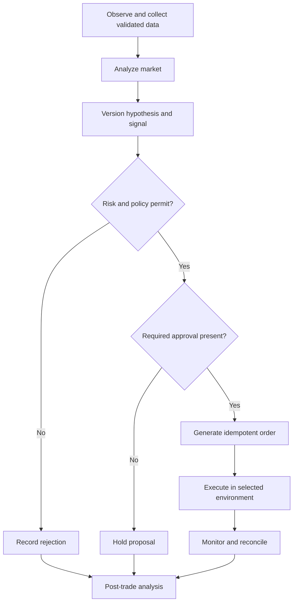

AI agents should remain subject to deterministic trading limits and explicit risk controls.

---

# Trading and Execution

The execution subsystem provides a conceptual framework for:

- order creation;
- order validation;
- order routing;
- order lifecycle management;
- execution reports;
- fills;
- cancellations;
- amendments;
- position reconciliation.

Supported execution technologies represented in the repository include:

- StockSharp;
- vn.py;
- WonderTrader;
- Cassandre;
- Fluent;
- OpenStock;
- Exchange-Core;
- broker APIs;
- exchange APIs.

---

# Market Data

The market-data layer should support:

- historical OHLCV;
- tick data;
- order books;
- trades;
- quotes;
- corporate actions;
- reference data;
- market calendars;
- alternative financial data.

A canonical normalized representation should be used before data is consumed by strategies.

Example:

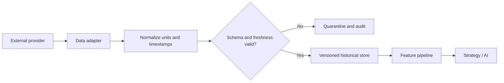

---

# Risk Management

Risk management is a first-class architectural component.

Potential capabilities include:

- position limits;
- notional limits;
- leverage limits;
- concentration limits;
- stop-loss policies;
- maximum drawdown;
- volatility monitoring;
- Value at Risk;
- Expected Shortfall;
- stress testing;
- scenario analysis;
- liquidity constraints;
- exposure monitoring.

**AI-generated decisions must never bypass deterministic risk controls.**

---

# Financial Messaging

## FIX Protocol

Financial Information eXchange connectivity can be implemented using technologies such as:

- QuickFIX/J;
- Philadelphia;
- other FIX protocol libraries;
- broker-specific FIX gateways.

The conceptual architecture is:

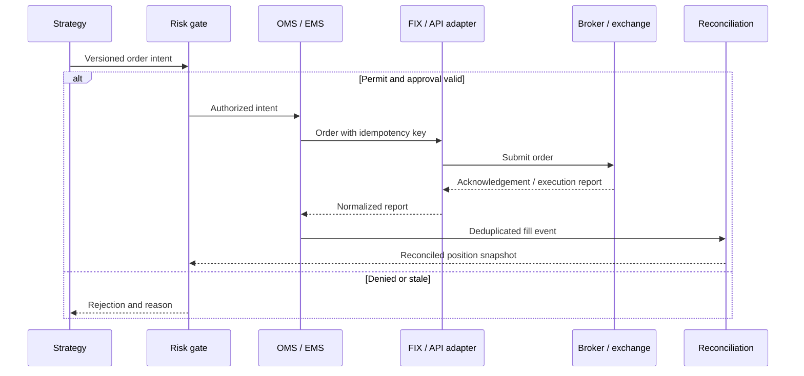

---

# Exchange and Matching Engine Integration

The repository includes technologies relevant to exchange infrastructure and market execution.

## Exchange-Core

Exchange-Core can be evaluated for high-performance matching-engine architectures.

## Trading Venue Infrastructure

The platform ecosystem also references:

- Parity;
- Exchange-Core;
- OPEX;
- StockSharp;
- broker APIs;
- cryptocurrency exchange APIs.

These technologies should be treated as **integration or reference components unless explicitly adopted by a concrete deployment**.

---

# Simulation and Backtesting

Before deployment to a live environment, strategies should pass through:

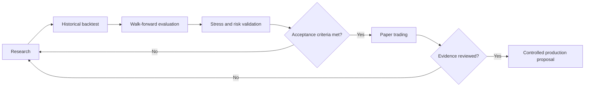

Simulation capabilities can include:

- historical replay;
- synthetic market generation;
- portfolio simulation;
- transaction-cost modeling;
- slippage;
- latency;
- liquidity;
- stress scenarios.

Candidate technologies include:

- Qlib;
- FinRL;
- TradeMaster;
- Mercury;
- market simulators;
- strategy backtesting frameworks.

---

# Business Intelligence

Business Intelligence provides visibility into financial and operational performance.

## BI Domains

### Trading Performance

- P&L;
- Sharpe ratio;
- Sortino ratio;
- maximum drawdown;
- win rate;
- profit factor;
- turnover;
- transaction costs.

### Portfolio Intelligence

- asset allocation;
- sector exposure;
- geographic exposure;
- factor exposure;
- volatility;
- correlation.

### Operational Intelligence

- order latency;
- execution quality;
- rejected orders;
- broker availability;
- API errors;
- market-data quality.

### AI Intelligence

- model accuracy;
- prediction drift;
- feature drift;
- agent decisions;
- strategy performance by model;
- model-versus-baseline performance.

---

# Software Dependency Compendium

The repository should maintain the technology inventory as a **software dependency compendium**, while distinguishing actual runtime dependencies from reference technologies.

## Quantitative Trading

| Technology | Domain | Classification |
|---|---|---|
| Qlib | AI quantitative investment | Core Candidate |
| FinRL | Reinforcement learning trading | Core Candidate |
| FinML | Financial machine learning | Optional |
| Shark | Algorithmic trading | Reference |
| Qbot | Quantitative investment | Reference |
| TradeMaster | Quantitative trading/RL | Research |
| WonderTrader | Quantitative trading | Optional |
| vn.py | Python trading framework | Optional |
| Cassandre | Trading bot framework | Optional |
| Fluent | Trading framework | Reference |

## Market Risk and Financial Mathematics

| Technology | Domain | Classification |
|---|---|---|
| QuantLib | Quantitative finance | Core Candidate |
| Strata | Analytics and market risk | Core Candidate |
| pyfolio | Portfolio performance/risk | Optional |
| OpenStock | Financial market platform | Reference |

## Trading Infrastructure

| Technology | Domain | Classification |
|---|---|---|
| StockSharp | Trading platform | Optional |
| Exchange-Core | Matching engine | Research/Core Candidate |
| OPEX | Exchange platform | Reference |
| Parity | Trading venue | Reference |
| OctoBot | Crypto trading | Optional |

## Financial Messaging

| Technology | Domain | Classification |
|---|---|---|
| QuickFIX/J | FIX protocol | Core Candidate |
| Philadelphia | FIX protocol | Optional |
| Aeron | High-performance messaging | Core Candidate |

## Broker and Market APIs

| Technology | Domain | Classification |
|---|---|---|
| Interactive Brokers API | Broker integration | Integration |
| Alpaca API | Algorithmic trading/broker | Integration |
| ExpertOption API | Trading API | Integration |
| Amadeus-like external APIs | External integration | Integration |

## AI and Agents

| Technology | Domain | Classification |
|---|---|---|
| TradingAgents | Multi-agent financial trading | Research |
| FinRL | Reinforcement learning | Core Candidate |
| Qlib | AI quantitative investment | Core Candidate |
| Qbot | AI investment | Research |
| TradeMaster | AI quantitative trading | Research |

## Financial Analytics

| Technology | Domain | Classification |
|---|---|---|
| Morpheus | High-performance analytics | Research |
| Strata | Market risk | Core Candidate |
| pyfolio | Portfolio analytics | Optional |
| QuantLib | Financial mathematics | Core Candidate |

## Engineering and Systems Modeling

| Technology | Domain | Classification |
|---|---|---|
| Arcadia | MBSE methodology | Reference |
| Capella | MBSE modeling | Reference |
| CAD | Engineering design | Reference |
| CAM | Manufacturing engineering | Reference |
| CAS | Simulation and analysis | Reference |

---

# Dependency Classification

The compendium uses the following classification:

| Classification | Meaning |
|---|---|
| Core Candidate | Recommended for the reference architecture |
| Runtime | Required by a concrete implementation |
| Optional | Useful but replaceable |
| Integration | External service/API |
| Research | Experimental or research-oriented |
| Reference | Used as architectural/technology reference |
| Development | Development tooling |
| Testing | Testing and validation |
| Legacy | Maintained for historical compatibility |
| Deprecated | Should not be selected for new implementations |

**Important:** the list above is an ecosystem inventory derived from the repository's current README. It should not be interpreted as a claim that every project is installed or required by the current codebase.

---

# Dependency Matrix

| Layer | Recommended Reference Technology |
|---|---|
| Language | Python / Java / C++ |
| Quantitative Finance | QuantLib |
| Quant Research | Qlib |
| Reinforcement Learning | FinRL |
| Trading Framework | vn.py / StockSharp |
| FIX | QuickFIX/J |
| Messaging | Aeron |
| Matching Engine | Exchange-Core |
| Portfolio Analytics | pyfolio |
| Market Risk | Strata |
| Data Processing | Python ecosystem |
| AI Agents | TradingAgents / agent framework |
| Storage | PostgreSQL / Parquet |
| Time Series | Specialized time-series storage |
| API | REST / WebSocket |
| Containerization | Docker |
| Orchestration | Kubernetes |
| Observability | OpenTelemetry |
| BI | Grafana / Superset / Metabase |
| Systems Engineering | Arcadia / Capella |

---

# Recommended Technology Stack

A practical open-source reference implementation could use:

```text
Python
 ├── Qlib
 ├── FinRL
 ├── QuantLib bindings
 ├── pandas / NumPy
 ├── PyTorch
 └── scikit-learn

Java
 ├── QuickFIX/J
 ├── Strata
 └── Aeron

Trading
 ├── vn.py
 ├── StockSharp
 └── Exchange-Core

Data
 ├── PostgreSQL
 ├── Parquet
 └── Object Storage

AI
 ├── LLM
 ├── Trading Agents
 ├── RAG
 └── Reinforcement Learning

Infrastructure
 ├── Docker
 ├── Kubernetes
 └── CI/CD

Observability
 ├── OpenTelemetry
 ├── Prometheus
 └── Grafana
```

---

# Data Architecture

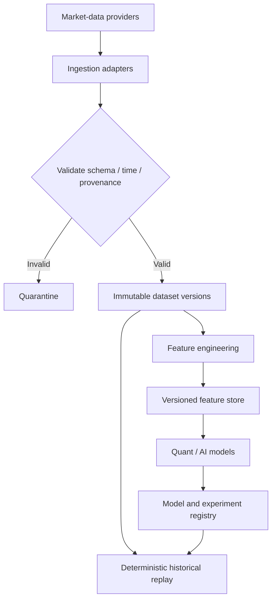

---

# AI Architecture

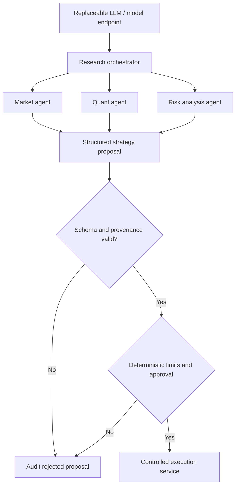

AI should provide recommendations, predictions or strategy proposals while deterministic controls govern financial execution.

---

# User Guide

## Typical Research Workflow

### Step 1 — Define the Strategy

Specify:

- asset universe;
- time horizon;
- trading frequency;
- entry conditions;
- exit conditions;
- risk constraints.

### Step 2 — Prepare Market Data

Load and validate:

```text
Prices
Volumes
Quotes
Trades
Fundamentals
Market Events
```

### Step 3 — Generate Features

Examples:

- moving averages;
- momentum;
- volatility;
- volume;
- technical indicators;
- statistical factors;
- alternative data.

### Step 4 — Train or Configure the Model

Use:

- supervised learning;
- unsupervised learning;
- reinforcement learning;
- statistical models;
- AI agents.

### Step 5 — Backtest

Evaluate:

- returns;
- volatility;
- drawdown;
- Sharpe;
- Sortino;
- turnover;
- transaction costs.

### Step 6 — Risk Validation

Verify that the strategy complies with predefined limits.

### Step 7 — Paper Trading

Execute against simulated or paper accounts.

### Step 8 — Production

Only validated strategies should reach live execution.

---

# Installation Guide

## System Requirements

The exact versions should be pinned according to the selected implementation.

Recommended baseline:

```text
Operating System:
  Linux x86_64

Python:
  3.11+

Java:
  JDK 17+

C++:
  C++17 or later

Container Runtime:
  Docker

Optional:
  Kubernetes
```

## Recommended Development Tools

```bash
git
python
pip
uv
java
maven
gradle
docker
docker-compose
```

## Clone Repository

```bash
git clone https://github.com/robotics-intelligent-systems/jfxai4ats.git
cd jfxai4ats
```

## Python Environment

```bash
python -m venv .venv
source .venv/bin/activate
```

Install project dependencies when a project-specific dependency file is available:

```bash
pip install -r requirements.txt
```

For `pyproject.toml`-based projects:

```bash
pip install -e .
```

## Java Components

For Maven-based modules:

```bash
./mvnw clean verify
```

For Gradle-based modules:

```bash
./gradlew build
```

## Docker

```bash
docker build -t jfxai4ats:latest .
```

Run:

```bash
docker run --rm jfxai4ats:latest
```

---

# Dependencies

The final implementation should document every executable dependency using the following structure:

| Dependency | Version | Purpose | License | Required |
|---|---|---|---|---|
| Python | 3.11+ | AI/quant services | PSF | Yes |
| Java | 17+ | FIX/financial services | OpenJDK distribution license | Optional |
| QuantLib | Pinned version | Financial mathematics | BSD-style | Optional |
| Qlib | Pinned version | Quant research | MIT | Optional |
| FinRL | Pinned version | RL trading | Open source | Optional |
| QuickFIX/J | Pinned version | FIX | BSD-style | Optional |
| Aeron | Pinned version | Messaging | Apache-2.0 | Optional |
| PostgreSQL | Pinned version | Persistence | PostgreSQL License | Optional |
| Docker | Current supported version | Containers | Apache-2.0 | Development |
| Kubernetes | Supported version | Orchestration | Apache-2.0 | Optional |

Versions should be updated to the exact versions validated by CI before a production release.

---

# Testing and Validation

The project should implement multiple levels of testing.

## Unit Tests

Validate:

- indicators;
- financial calculations;
- portfolio calculations;
- risk formulas;
- order validation;
- strategy logic.

## Integration Tests

Validate:

- broker APIs;
- FIX gateways;
- market-data adapters;
- databases;
- messaging;
- exchange adapters.

## Backtesting Tests

Validate:

- deterministic results;
- historical data integrity;
- transaction costs;
- slippage;
- latency assumptions.

## AI Evaluation

Evaluate:

- predictive performance;
- model stability;
- data leakage;
- overfitting;
- distribution shift;
- model drift.

## Production Validation

Before enabling live trading:

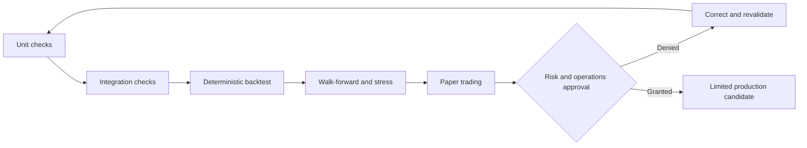

---

# Security and Financial Controls

Security is critical because the platform can potentially interact with financial accounts and trading venues.

## Credential Management

Never store:

```text
API keys
Secrets
Passwords
Private keys
Broker credentials
```

directly in source code.

Use:

- environment variables;
- secret managers;
- encrypted configuration;
- managed identity;
- Kubernetes Secrets with appropriate protection.

## Trading Controls

Every live execution environment should implement:

- maximum order size;
- maximum daily loss;
- maximum exposure;
- position limits;
- rate limits;
- kill switch;
- emergency shutdown;
- audit logs.

## AI Safety

AI agents must not be allowed to directly override:

- risk limits;
- compliance rules;
- position limits;
- account permissions;
- emergency controls.

---

# Repository Structure

A recommended repository structure is:

```text
jfxai4ats/
│
├── README.md
├── LICENSE
├── CONTRIBUTING.md
├── CODE_OF_CONDUCT.md
│
├── docs/
│   ├── architecture/
│   ├── user-guide/
│   ├── installation/
│   ├── dependencies/
│   │   ├── software-compendium.md
│   │   └── dependency-matrix.csv
│   ├── trading/
│   ├── risk/
│   ├── ai/
│   └── mbse/
│
├── src/
│   ├── data/
│   ├── features/
│   ├── models/
│   ├── strategies/
│   ├── portfolio/
│   ├── risk/
│   ├── execution/
│   ├── brokers/
│   ├── exchanges/
│   ├── fix/
│   ├── agents/
│   └── analytics/
│
├── tests/
│   ├── unit/
│   ├── integration/
│   ├── backtesting/
│   └── performance/
│
├── notebooks/
│   ├── research/
│   ├── experiments/
│   └── backtesting/
│
├── config/
│
├── docker/
│
├── k8s/
│
├── scripts/
│
└── MBSE/
    ├── Arcadia/
    ├── CAD/
    ├── CAM/
    └── CAS/
```

---

# Development Workflow

Recommended development lifecycle:

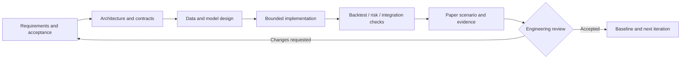

Git workflow:

```text
main
 │
 ├── feature/*
 ├── fix/*
 ├── research/*
 └── experiment/*
```

Pull requests should include:

- problem statement;
- architectural impact;
- tests;
- performance considerations;
- risk implications;
- documentation updates.

---

# Iterative development

[Engineering iteration table](docs/development/iterative-development.md) tracks ATS-MBSE-001 documentation review ([issue #2](https://github.com/robotics-intelligent-systems/jfxai4ats/issues/2)) and ATS-PILOT-002, the proposed offline trade-record and reconciliation pilot ([issue #1](https://github.com/robotics-intelligent-systems/jfxai4ats/issues/1)). AI assists requirements, design, implementation, verification and documentation; engineering reviews acceptance evidence. Maturity remains architecture (~20%) until an executable milestone is demonstrated.

---

# Contribution

Contributions are welcome.

Recommended contribution process:

1. Fork the repository.
2. Create a feature branch.
3. Implement the change.
4. Add tests.
5. Update documentation.
6. Validate dependency licenses.
7. Run the complete test suite.
8. Open a Pull Request.

Example:

```bash
git checkout -b feature/new-trading-strategy
```

```bash
git add .
git commit -m "feat: add new trading strategy"
git push origin feature/new-trading-strategy
```

---

# Code of Conduct

All contributors should maintain a professional and respectful environment.

Contributions should:

- respect other developers;
- document technical decisions;
- avoid malicious trading logic;
- avoid credential exposure;
- avoid intentionally unsafe financial automation;
- follow the project's security policies.

A dedicated `CODE_OF_CONDUCT.md` should be maintained in the repository root.

---

# Authors

**Robotics Intelligent Systems**

Repository:

https://github.com/robotics-intelligent-systems/jfxai4ats

The repository should be used to identify current maintainers and contributors.

---

# Additional Information

## Related Engineering Domains

JFXAI4ATS follows the broader engineering structure used by the Robotics Intelligent Systems repositories:

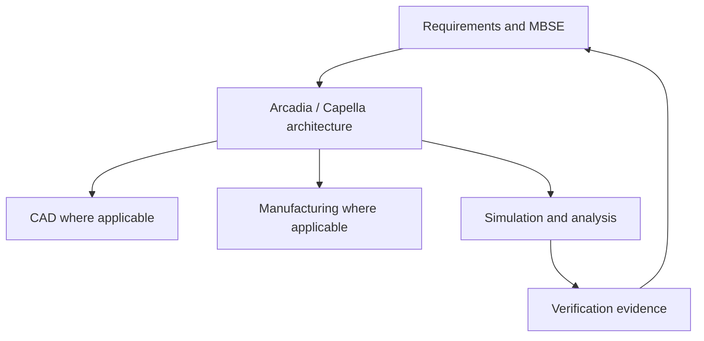

This allows financial trading-system architecture to be connected to a broader Model-Based Systems Engineering methodology.

## Related Open-Source Ecosystems

The project can be evaluated alongside:

- Qlib;
- FinRL;
- QuantLib;
- Strata;
- StockSharp;
- vn.py;
- QuickFIX/J;
- Aeron;
- Exchange-Core;
- TradingAgents;
- TradeMaster;
- WonderTrader.

These projects should be considered complementary technologies, references, or integration candidates rather than automatically implied dependencies.

---

# License

The license for JFXAI4ATS should be explicitly defined in the repository's root `LICENSE` file.

If the repository has not yet selected a license, contributors should evaluate an appropriate open-source license before distributing executable software.

Potential choices include:

- Apache-2.0;
- MIT;
- BSD-3-Clause;
- GPL-3.0;
- AGPL-3.0.

The final choice should account for the licensing requirements of the dependencies incorporated into the implementation.

---

# Roadmap

## Phase 1 — Documentation

- [x] Repository technology inventory
- [x] Architecture definition
- [x] Dependency compendium
- [ ] Dependency versions
- [ ] License verification
- [ ] Installation automation

## Phase 2 — Quantitative Research

- [ ] Data ingestion
- [ ] Feature engineering
- [ ] Backtesting engine
- [ ] Quantitative strategies
- [ ] Portfolio analytics

## Phase 3 — AI

- [ ] ML pipelines
- [ ] Reinforcement learning
- [ ] Trading agents
- [ ] LLM integration
- [ ] Model evaluation
- [ ] Model registry

## Phase 4 — Trading Infrastructure

- [ ] OMS
- [ ] EMS
- [ ] FIX integration
- [ ] Broker adapters
- [ ] Exchange adapters
- [ ] Matching engine integration

## Phase 5 — Risk

- [ ] Position limits
- [ ] Exposure controls
- [ ] Drawdown controls
- [ ] Stress testing
- [ ] Automated risk engine

## Phase 6 — Cloud

- [ ] Docker
- [ ] Kubernetes
- [ ] CI/CD
- [ ] Observability
- [ ] Production deployment

---

# Architectural Principles

JFXAI4ATS should follow these principles:

1. **Research before production**
2. **Risk before execution**
3. **AI-assisted, policy-controlled automation**
4. **Reproducible quantitative experiments**
5. **Open-source interoperability**
6. **API-first integration**
7. **Observable systems**
8. **Secure financial credentials**
9. **Deterministic execution controls**
10. **Clear separation between reference technologies and actual dependencies**

---

# Conclusion

JFXAI4ATS provides a structured open-source foundation for exploring the convergence of **quantitative finance, artificial intelligence, algorithmic trading, financial messaging, market infrastructure, risk management and Model-Based Systems Engineering**.

Rather than representing a single monolithic trading application, the repository acts as an **architectural and software ecosystem for constructing automated trading platforms** from interchangeable open-source components.

The resulting architecture enables a progression from:

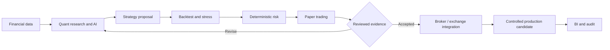

This approach provides a foundation for developing auditable, modular and extensible AI-powered trading systems while maintaining explicit separation between experimentation, simulation and real financial execution.

